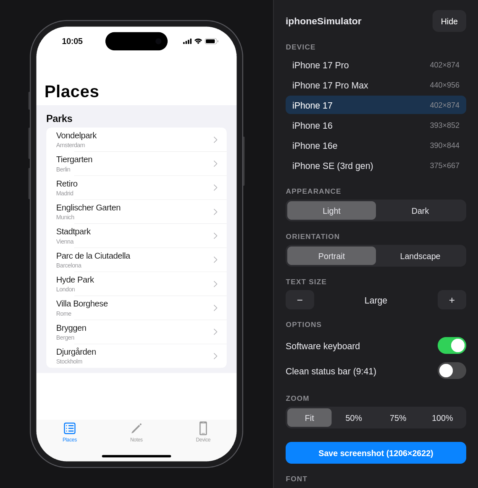
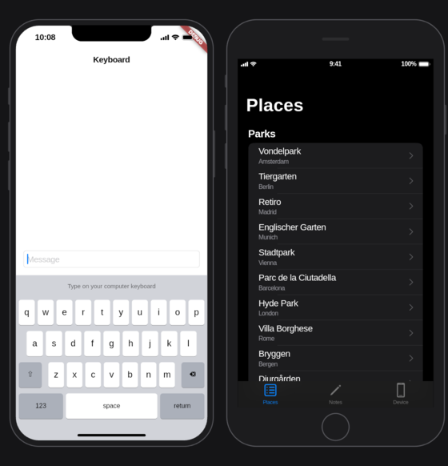

# iphoneSimulator

Run your Flutter app on Linux inside an iPhone: the right screen size, safe
areas, Dynamic Island, status bar, keyboard and touch input, with hot reload.
No Mac needed.



## What this is (and isn't)

Apple's Simulator only runs on macOS: it runs apps compiled for the Mac against
Apple's own simulator frameworks. Those can't be run on Linux, and this project
doesn't try.

Instead, `iphonesim` runs your app's **Dart code** on Linux and tells it,
everywhere it matters, that it is on an iPhone:

- `defaultTargetPlatform` is iOS, so Material and Cupertino widgets behave as
  on iOS: page transitions, back-swipe, bouncing scroll, text selection.
- `MediaQuery` reports the phone's size, pixel ratio, safe areas, keyboard,
  appearance and text size.
- Mouse clicks and drags on the screen become touches.

Flutter draws every pixel itself, so what you see is very close to what the
phone shows. What isn't simulated is **native code**: plugins run their Linux
implementation if they have one (see [Plugins](#plugins)). Use it to work on UI
and flows quickly, and keep testing on a real iPhone before you ship.

## Features

- **Devices:** iPhone 17 Pro, 17 Pro Max, 17, 16, 16e (notch) and SE (home
  button), in portrait and landscape.
- **Screen:** logical size, pixel ratio, safe areas, rounded corners, Dynamic
  Island or notch, home indicator.
- **Status bar:** real time and laptop battery. The text turns white or black
  following the app's `AppBar`, `CupertinoNavigationBar`, `AnnotatedRegion` or
  `SystemChrome` calls. It hides in landscape and in immersive mode.
- **Keyboard:** when a text field is focused, an iOS keyboard slides up and the
  app gets matching `viewInsets`, so you can see what it covers. You type on
  your own keyboard. Ctrl+C/V/X/Z work in text fields.
- **Settings:** light/dark appearance, Dynamic Type sizes (Extra Small to AX5),
  orientation (respects the app's `setPreferredOrientations`), zoom.
- **Screenshots** at the device's native resolution (for example 1206×2622 for
  the iPhone 17 Pro, a size App Store Connect accepts), with an optional clean
  9:41 status bar. Like on a phone, the status bar and keyboard are included
  and the Dynamic Island and home indicator aren't.
- **Plugin log:** calls to plugins with no Linux implementation are listed in
  the panel and in the terminal.
- **Hot reload** and hot restart, as with any `flutter run`.
- Remembers device and settings per project.



## Requirements

- Linux with Flutter 3.27 or newer, with the Linux desktop target set up
  (`flutter doctor` shows "Linux toolchain"). Tested with Flutter 3.47 on Arch.
- Optional, recommended: a San Francisco look-alike font. Without it, iOS
  text uses your desktop font.
  - [Inter](https://rsms.me/inter/) (open source): `pacman -S inter-font`,
    `apt install fonts-inter`.
  - Or Apple's SF Pro from <https://developer.apple.com/fonts/>, installed
    yourself. Its license allows mock-ups of iOS apps; this project never
    ships it.

## Install

```sh
git clone https://github.com/anelcelik/iphoneSimulator
cd iphoneSimulator
tool/install.sh          # builds one binary into ~/.local/bin/iphonesim
iphonesim doctor
```

## Use

From your Flutter project:

```sh
iphonesim run                    # build and launch; r / R in the terminal for hot reload / restart
iphonesim run -d iphone-se       # start on another device (the panel can switch any time)
iphonesim run -- --dart-define=API=staging   # anything after -- goes to flutter run
iphonesim devices                # list devices
```

The first run needs a Linux runner (`linux/` folder). If your project has none,
`iphonesim run --add-linux` adds one. It creates `linux/` only and changes no
other files.

Everything else `iphonesim` writes goes into `build/iphonesim/`, which Flutter
projects already ignore in git. Your code doesn't change and doesn't need a new
dependency.

### From VS Code

Run `iphonesim prepare` once (and again after updating iphonesim), then add a
launch configuration:

```json
{
  "name": "iPhone simulator",
  "request": "launch",
  "type": "dart",
  "program": "build/iphonesim/main.dart",
  "deviceId": "linux"
}
```

### Options

| Option | |
|---|---|
| `-d, --device` | Device to start with (later runs remember the panel's choice). |
| `-t, --target` | App entrypoint (default `lib/main.dart`). |
| `--strict-plugins` | Let calls to missing plugins throw, as they would without the simulator. |
| `--ios-from-start` | Report iOS from the first line of `main()` (see below). |
| `--screenshots <dir>` | Screenshot folder (default `~/Pictures/iphoneSimulator`). |
| `--add-linux` | Add a Linux runner if the project has none. |

`IPHONESIM_VERBOSE=1` logs the system calls the simulator reacts to (status
bar style, keyboard, orientation).

## How it works

`iphonesim run` generates `build/iphonesim/main.dart`, which imports your
`lib/main.dart` and calls its `main()` inside the simulator's own Flutter
binding. That binding:

1. **Wraps the root widget.** `runApp()` calls `wrapWithDefaultView`. The
   binding overrides it to put your app inside the simulator window, below a
   `MediaQuery` describing the phone. Your app keeps its state across device,
   orientation and appearance changes.
2. **Switches to iOS at `runApp()`.** Code that runs before `runApp()` still
   sees Linux. That's where apps set up platform services, such as sqflite's
   FFI database factory, and those need to pick their Linux implementation.
   `--ios-from-start` changes this.
3. **Watches platform channels.** A `BinaryMessenger` in front of the engine
   sees `SystemChrome` and `TextInput` calls, which the Linux embedder ignores,
   and answers plugin calls nothing on Linux handles.
4. **Turns mouse into touch.** Pointer events on the screen area are rewritten
   from mouse to touch, and hovering over the screen is dropped (fingers don't
   hover).

The window, frame, status bar and keyboard are plain Flutter widgets, drawn
programmatically. No Apple artwork is used.

## Plugins

Plugins with a Linux implementation (shared_preferences, path_provider,
sqflite via sqflite_common_ffi, url_launcher, ...) just work.

When a call reaches a plugin that has no Linux implementation, the simulator
answers it with `null` so the app keeps running, and lists it in the panel. For
example:

```
[iphonesim] No Linux implementation for flutter_timezone · getLocalTimezone (answered with null).
```

Code that expects a value will still fail at that point, as it would on any
platform without the plugin. `--strict-plugins` restores the normal
`MissingPluginException`.

## Limitations

- **`Platform.isIOS` stays false.** `dart:io`'s `Platform` can't be overridden.
  `defaultTargetPlatform` is iOS, and it's what Flutter itself uses.
- **Debug builds only.** Flutter only lets an app pretend to be another
  platform in debug mode.
- **Native code isn't simulated:** camera, notifications, iCloud, HealthKit,
  in-app purchase and so on need a real device.
- `View.of(context)` and `PlatformDispatcher` still describe the Linux window.
  Apps that read sizes there instead of `MediaQuery` see the window.
- One finger: no pinch or multi-touch yet.
- Ctrl+A in text fields moves to the start of the line, as on a Mac.
- Device measurements are close, not exact: safe areas and corner radii come
  from public measurements and may be off by a point.

## Roadmap

- **SwiftUI apps:** compile SwiftUI sources (for example from
  [xtool](https://github.com/xtool-org/xtool) projects) for Linux against
  [SwiftOpenUI](https://github.com/codelynx/SwiftOpenUI) and draw them in this
  same window with an iOS look. Research stage.
- Pinch and two-finger gestures (Option+drag in Xcode's Simulator).
- Locale and region switching; iPad profiles.
- Mock presets for common iOS-only plugins.
- Video recording.

## Developing

```
packages/iphonesim_shell/   Flutter package: the simulator window (runs inside the app)
packages/iphonesim/         Dart CLI; embeds the shell's sources at build time
example/                    Cupertino demo app
```

```sh
cd packages/iphonesim_shell && flutter test
cd packages/iphonesim && dart run tool/bundle_shell.dart && dart test
```

After changing the shell, run `dart run tool/bundle_shell.dart` (a test fails
if the embedded copy is stale). The shell compiles inside apps with their own
language version, so it sticks to Dart 3.0 syntax.

`IPHONESIM_SELFTEST_SHOT=out.png iphonesim run` saves a capture of the whole
window after a few seconds (`IPHONESIM_SELFTEST_DELAY`), then quits. It's useful
for checking rendering without clicking around.

## License

MIT, see [LICENSE](LICENSE).

iPhone and iOS are trademarks of Apple Inc. This project is not affiliated
with, endorsed or sponsored by Apple.
